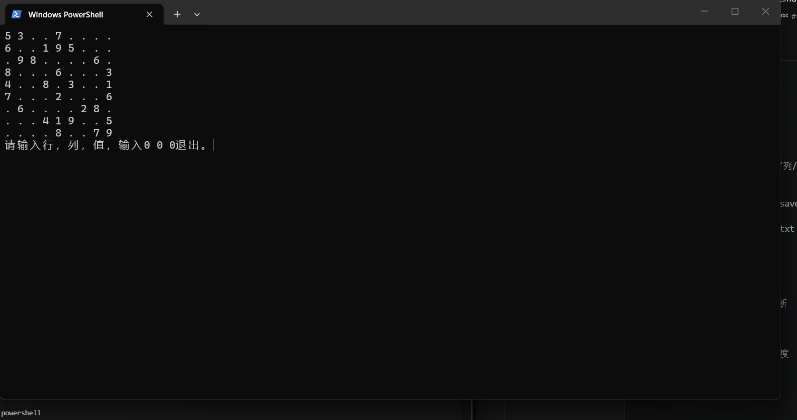

# sudoku-clone

一个 7 天内写出来的初学者练习用 Windows 控制台数独仿版。
原项目:https://github.com/mayerui/sudoku/

## 怎么跑

### 方式 A：Visual Studio
用 Visual Studio 打开 `sudoku-compiler.slnx`，选择 x64 Debug，生成并运行。

### 方式 B：g++
需要 Windows + MinGW g++：

```powershell
g++ -std=c++17 -Wall -Wextra src/main.cpp -o sudoku.exe
.\sudoku.exe

```

## 操作

### 输入三个整数:
行 列 值
行、列：1～9
值：1～9 填数，0 清空
0 0 0 退出
题面数字不能修改；与行/列/宫冲突的数字会被拒绝。

### 存档
退出（0 0 0）时自动写 save.txt
下次启动自动读取
想重新开始：删除 save.txt

## 我改了什么
相对原项目，保留了：

9×9 固定题目
输入、冲突检测、胜利判断
单文件存档
砍掉了：

随机生成 / 唯一解 / 难度
光标移动 / 撤销
颜色 / 边框 / 中英文
多存档

## 卡在哪
固定一局题，没有随机生成
提示信息在下一轮循环开头才打印
只支持 Windows 控制台

## 截图
